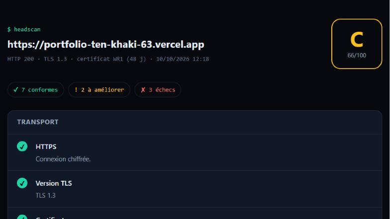
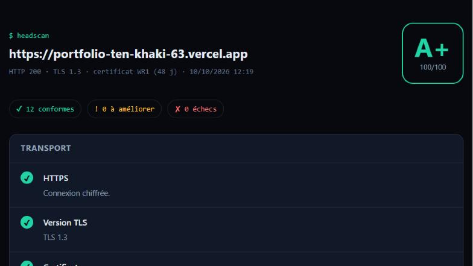

# headscan

Un auditeur de sécurité web en ligne de commande, écrit en **Go**, sans aucune dépendance externe.

On lui donne une URL. Il analyse les **en-têtes de sécurité HTTP**, les **cookies**, la configuration **TLS**, puis donne une **note de A+ à F** avec des conseils de correction concrets.

```
$ headscan example.com

headscan → https://example.com
  HTTP 200 · 278 ms

Transport
  ✔ HTTPS                        Connexion chiffrée.
  ✔ Version TLS                  TLS 1.3
  ✔ Redirection HTTP → HTTPS     308 vers https://example.com/

En-têtes
  ✘ Content-Security-Policy      Absent : aucune défense en profondeur contre les failles XSS.
    → Définir une politique, par exemple : default-src 'self'; object-src 'none'; frame-ancestors 'none'
  ...

Note : C (66/100)
```

## 🔴 Essayer en ligne

**[portfolio-ten-khaki-63.vercel.app/lab/headscan](https://portfolio-ten-khaki-63.vercel.app/lab/headscan/)**

Entrez une URL : le scan est fait par une fonction serverless Go hébergée sur Vercel, avec le même moteur que la ligne de commande (package [`scan`](scan/)). Un service qui scanne des URL à la demande peut être détourné contre des cibles internes. Le mode sécurisé (`scan.NewSafeScanner`) protège contre ces abus :

| Risque | Protection |
|---|---|
| **SSRF** : faire scanner `localhost`, le réseau interne ou `169.254.169.254` (métadonnées cloud) | Seules les IP **publiques** sont joignables (`scan.IsPublicIP`). Les plages privées, locales, réservées et NAT64 sont bloquées. |
| Contournement par redirection ou **DNS rebinding** | Le contrôle est fait **au moment de la connexion** (dialer personnalisé), pas sur l'URL : il s'applique aussi aux redirections et à l'IP réellement contactée. |
| Scan de services internes | Ports **80 et 443** uniquement, pas de proxy. |
| Saturation | Délais courts, en-têtes limités à 64 Ko, limite de débit par IP, cache de 5 minutes par URL. |
| XSS via les en-têtes d'un site malveillant | L'interface affiche les résultats avec `textContent`, jamais comme du HTML. |

## Cas réel : mon propre portfolio

J'ai d'abord lancé l'outil sur [mon portfolio](https://portfolio-ten-khaki-63.vercel.app). Il a obtenu **C**, à cause de 3 échecs et 2 avertissements : pas de CSP, pas de protection contre le clickjacking, pas de `nosniff`…

J'ai corrigé ces points dans la configuration Vercel (`vercel.json`), puis relancé l'analyse : le site obtient **A+**.

| Avant | Après |
|---|---|
|  |  |

## Ce qui est vérifié

| Catégorie | Vérification | Pourquoi c'est important |
|---|---|---|
| Transport | HTTPS, version TLS (≥ 1.2), expiration du certificat | Chiffrement des échanges |
| Transport | Redirection `http://` → `https://` | Évite qu'un utilisateur reste en clair |
| En-têtes | `Strict-Transport-Security` (durée ≥ 6 mois) | Bloque le *SSL stripping* |
| En-têtes | `Content-Security-Policy` (détecte `unsafe-inline`, `unsafe-eval`, `*`) | Défense en profondeur contre les XSS |
| En-têtes | `X-Frame-Options` / `frame-ancestors` | Protection contre le *clickjacking* |
| En-têtes | `X-Content-Type-Options: nosniff` | Empêche le *MIME sniffing* |
| En-têtes | `Referrer-Policy`, `Permissions-Policy` | Limite les fuites d'URL et l'accès aux API sensibles |
| Cookies | `Secure`, `HttpOnly`, `SameSite` | Protège les sessions (vol par XSS, CSRF) |
| Fuites | Version dans `Server`, présence de `X-Powered-By` | Ne pas aider un attaquant à cibler des failles connues |

Chaque vérification a un poids. Un échec retire tous ses points, un avertissement la moitié. Le score sur 100 est ensuite converti en note.

## Installation

Prérequis : [Go 1.22+](https://go.dev/dl/).

```bash
go install github.com/yaniscalo36-commits/headscan@latest
```

ou depuis le code source :

```bash
go build -o headscan .
```

## Utilisation

```bash
headscan example.com                          # rapport dans le terminal
headscan -html rapport.html example.com       # rapport HTML autonome
headscan -json example.com                    # sortie JSON (scripts, outils)
headscan -min-grade B example.com             # code de sortie 2 si la note est < B
```

| Option | Rôle |
|---|---|
| `-html fichier` | Écrit un rapport HTML (un seul fichier, sans dépendance) |
| `-json` | Affiche le résultat complet en JSON |
| `-min-grade X` | Fait échouer la commande (code 2) si la note est inférieure à X : pratique en **CI/CD** |
| `-timeout 10s` | Délai maximum par requête |
| `-no-color` | Désactive les couleurs (aussi via la variable `NO_COLOR`) |

### Exemple d'intégration continue (GitHub Actions)

```yaml
- name: Audit des en-têtes de sécurité
  run: go run github.com/yaniscalo36-commits/headscan@latest -min-grade A https://mon-site.fr
```

Le pipeline échoue si quelqu'un retire un en-tête de sécurité par erreur.

## Tests

```bash
go test ./...
```

Les tests lancent de vrais serveurs HTTP et HTTPS locaux (`httptest`), configurés bien ou mal, et vérifient le diagnostic : pas besoin d'Internet.

## Usage responsable

`headscan` envoie **une seule requête GET** (et une sur `http://` pour la redirection), comme un navigateur. Il ne tente aucune attaque. Utilisez-le sur vos propres sites ou sur ceux que vous êtes autorisé à auditer.

## Utilisation comme bibliothèque Go

```go
import "github.com/yaniscalo36-commits/headscan/scan"

r, err := scan.NewSafeScanner(5 * time.Second).Scan("example.com")
if err != nil { /* errors.Is(err, scan.ErrBlockedTarget) si la cible est interne */ }
fmt.Println(r.Grade, r.Score)
```

`scan.NewScanner` (utilisé par la ligne de commande) autorise les adresses internes, pratique pour auditer un serveur de son réseau local. `scan.NewSafeScanner` est destiné aux services exposés publiquement.

## Organisation Git

- `main` : version stable
- `develop` : intégration
- `feature/scanner`, `feature/reports`, `feature/api`, `docs/readme` : une branche par fonctionnalité

---

Projet personnel de [Yanis Calonge](https://portfolio-ten-khaki-63.vercel.app), étudiant en Bachelor Cybersécurité à Ynov Toulouse.
